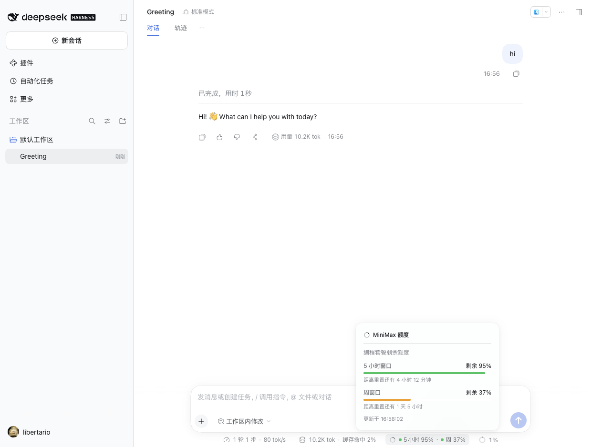
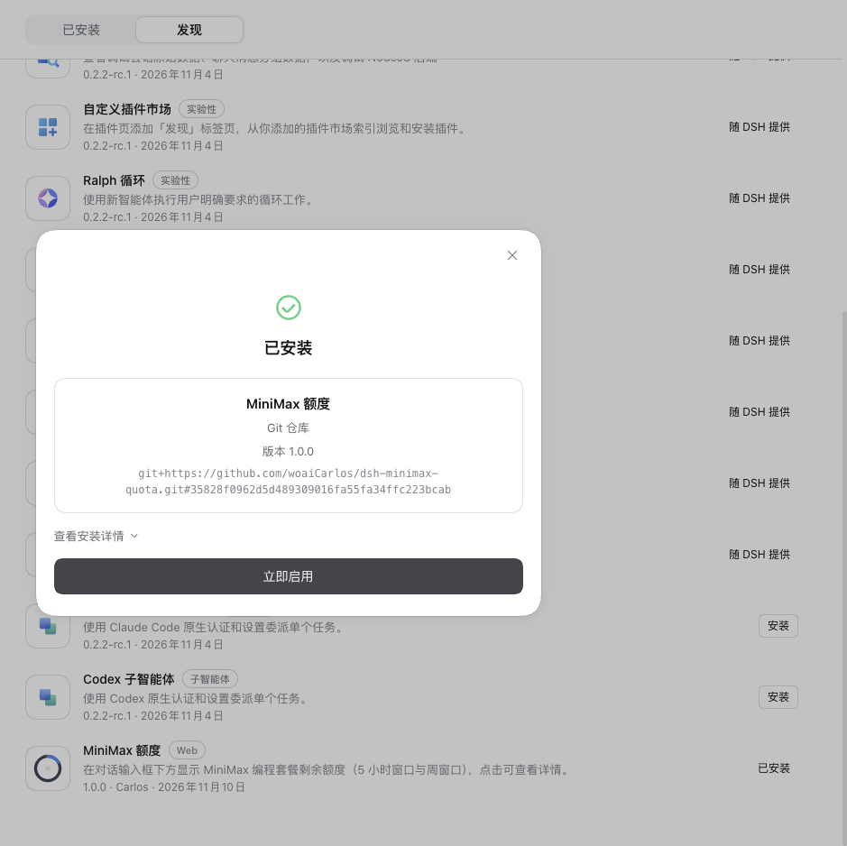

# @woaicarlos/dsh-minimax

Shows the remaining **MiniMax Coding Plan quota** below the DeepSeek Harness chat composer: how much is left in the rolling 5-hour window and in the weekly window. Click the pill for the details. It also watches for models MiniMax has just released and appends them to your pi-ai model list.



- Appears only when the session has a **MiniMax-family model** selected (provider or model name contains `minimax`).
- The pill reads `5h 95% · Week 37%`, each number with a status dot: green (>40%), amber (≤40%), red (≤15%).
- Clicking opens a panel: remaining percentage per window, a progress bar, time until each window resets, and when the reading was fetched.
- Follows the host light/dark theme; all visible text goes through the Harness locale service (Chinese and English included).
- It also appends newly released MiniMax models to your configured model list — append only: nothing is removed, nothing is reordered, and the entries themselves come back as they are unless your profile override carries no MiniMax model list of its own (see "Automatic model sync" below).

## Install

The plugin is distributed from **this Git repository**, not from npm. The package name is
`@woaicarlos/dsh-minimax` (the `@woaicarlos` scope does not exist on npm yet — the name is reserved
for it, and a future registry release would use it as it stands); **the repository name is still
`dsh-minimax-quota`** — installing, cloning and the community catalog entry all name the repository,
so the package rename leaves them alone:

```bash
dsh plugin --profile <your profile> add github:woaiCarlos/dsh-minimax-quota
```

Or clone and install from the local directory:

```bash
git clone https://github.com/woaiCarlos/dsh-minimax-quota.git
dsh plugin --profile <your profile> add file:./dsh-minimax-quota
```

The plugin then appears under **Plugins → Installed** as “MiniMax Quota”. Flip it on and it works; a Harness restart keeps it.

> You still need a MiniMax route in your profile. Add a MiniMax provider with your API key under **Settings → Models** first — the plugin reads the quota of that route.

## Showing up in a plugin market

The plugin is already listed in the local plugin market's **Discover** tab (its index entry pins a GitHub source to an exact commit, so one click installs it).



To appear in the **community market** (the awesome-dsh-plugin catalog the third-party market discovers from), open a PR against
[awesome-dsh-plugin](https://github.com/awesome-dsh-plugin/awesome-dsh-plugin) that adds a single file:

```yaml
# data/plugins/woaiCarlos__dsh-minimax-quota.yml
url: https://github.com/woaiCarlos/dsh-minimax-quota
name: woaiCarlos/dsh-minimax-quota
category: usage
description:
  en: 'Shows the remaining MiniMax coding-plan quota below the DeepSeek Harness chat composer, and keeps the profile''s MiniMax model list current by appending newly released models.'
  zh: '在对话输入框下方显示 MiniMax 编程套餐剩余额度，并把新发布的模型追加到配置的模型列表里。'
icon: https://raw.githubusercontent.com/woaiCarlos/dsh-minimax-quota/main/assets/icon-180.png
```

A ready-made copy lives in [`catalog/awesome-dsh-plugin.yml`](catalog/awesome-dsh-plugin.yml). The repository already carries the `dsh-plugin` topic.

That catalog's CI checks that the repository is **at least one day old**. This repository was created at 2026-11-10 09:04 UTC, so the PR can go in from 2026-11-11 09:04 UTC onward.

## Releasing

The plugin's **distribution channel is this Git repository**, not npm. Commit and push:

```bash
git commit -am "..." && git push
```

The market index entry pins a version to a commit SHA, so after each release update the
`commit` field in `plugin-market/git-plugins.json` and regenerate the index:

```sh
cd plugin-market
DSH_MARKET_ON_DEMAND="$PWD/on-demand.json" node generate-index.mjs
```

### If you ever also want to publish to npm

The repository already carries npm's official **trusted publishing (OIDC)** workflow
(`.github/workflows/publish.yml`), which keeps no long-lived npm token in CI.

One-time setup (the package settings page on npmjs.com):

The package name a release would go out under is `@woaicarlos/dsh-minimax`.

| Field | Value |
| --- | --- |
| Select your publisher | GitHub Actions |
| Organization or user | `woaiCarlos` |
| Repository | `dsh-minimax-quota` |
| Workflow filename | `publish.yml` |

The workflow is **manual only** (`workflow_dispatch`) for now, because the package does not
exist on npm yet and an automatic trigger would fail on every release tag. After the first
successful publish you can switch it to a tag trigger:

```yaml
on:
  push:
    tags:
      - 'v*'
  workflow_dispatch:
```

The very first publish (the package does not exist on npm yet, so a trusted publisher cannot
be configured) uses a one-time code from your authenticator:

```bash
npm publish --otp=<6-digit code from your authenticator app>
```

## Does my API key leak?

**No.** Specifically:

1. **The repository contains no secret.** The only thing in the source is the *credential reference* `MINIMAX_CN_API_KEY` — the name of the key to look up, not the key itself. The whole directory was secret-scanned before publishing; there is not a single real `sk-…` value in it.

2. **The key stays in the Host process.** The Host half reads it with `ctx.credentials.resolve('MINIMAX_CN_API_KEY')` and uses the value only to build the `Authorization: Bearer …` header for the MiniMax request. It never appears in the JSON the route returns.

3. **The browser never receives it.** The browser only calls the same-origin route `/plugin/minimax/status`, which returns percentages and reset timestamps:

   ```json
   {
     "ok": true,
     "intervalRemainingPercent": 95,
     "weeklyRemainingPercent": 37,
     "intervalResetAt": 1794316261854,
     "weeklyResetAt": 1794407213154,
     "intervalStatus": 1,
     "weeklyStatus": 1,
     "fetchedAt": 1794300583689
   }
   ```

### Will it pick up my key automatically after install?

**Yes, as long as your MiniMax key is configured the standard way** — because Harness addresses its credential store by environment-variable name:

| How you configured the key | Does the plugin find it? |
| --- | --- |
| Typed into **Settings → Models** for MiniMax | ✅ yes, **no extra step** |
| `export MINIMAX_CN_API_KEY=sk-…` before launching | ✅ yes |
| Written in the project `.env` or `~/.dsh/.env` | ✅ yes |
| Stored under some other environment variable name | ❌ configure it explicitly, see below |

The reason is that the Harness **Models page** derives the reference name from the provider route id when you type a key for it:

```
minimax-cn  →  MINIMAX_CN_API_KEY
```

which is exactly the name this plugin looks up. So **if MiniMax is already configured in your Models settings, the plugin works the moment you install it** — it never guesses at other key names.

Lookup order (the credential store's fixed precedence; the first place with a value wins):

```
1. the stored credential file   ~/.dsh/.credentials.yaml   ← what the Models page writes
2. the launching environment    MINIMAX_CN_API_KEY=… dsh
3. the project .env             <cwd>/.env
4. the home .env                $DSH_HOME/.env
```

### Using a different reference name

If your key lives under another environment variable name, change the plugin config in `cordis.patch.yml`:

```yaml
- insert:
    - id: minimax
      name: '@woaicarlos/dsh-minimax'
      config:
        credentialRef: MY_MINIMAX_KEY
```

## Configuration

| Field | Default | Meaning |
| --- | --- | --- |
| `credentialRef` | `MINIMAX_CN_API_KEY` | The credential reference to read. A reference name in the credential store: letters, digits and underscores, not starting with a digit. |

## How it works

```
index.js    Host half: resolve credential → call MiniMax → serve the quota on the same-origin route /plugin/minimax/status
client.js   Browser half: register a pill below the composer, click opens the details panel
locale/     Chinese and English strings
```

### Automatic model sync

The plugin probes the models MiniMax has just released and appends them to the `providers.minimax-cn.models` list in the pi-ai configuration.
Every new model is measured: whether it still answers, what its maximum output per call is, and whether it supports thinking.
**The entries you already have are never removed and never reordered** — the plugin only appends; their values are not rewritten either, unless your profile override carries no MiniMax model list of its own (see below). A model you deleted by hand is not added back either.

A few things are worth knowing about the write: the **route-level defaults the pi-ai schema resolves** (`defaultContextWindow`, `defaultMaxTokens` and the like) land in that route in the profile patch along with the new list, and the write puts the **whole effective `providers` map** into the patch, so **every other provider route you have** — including one configured only in an inherited layer — lands in the patch too, carrying its own schema-resolved defaults, while a profile override that carries no MiniMax model list of its own means the entries written back are the effective projection's, already carrying a materialised `compat` block.

**The model entries you wrote are written back as they are** — but only when your profile override carries a MiniMax model list of its own.

### When the sync runs

| When | What happens |
| --- | --- |
| After the plugin starts | One sync once the profile has loaded (up to five attempts) |
| Every 24 hours | One sweep of MiniMax's model list; a newly released model is appended |
| The "Sync now" button in the panel | One sync right away; the panel says whether it worked |

A quiet day costs **one model-list request**: the models the plugin added before, and the models MiniMax has retired, are remembered in the plugin's own state file and are never probed again. A retired model is probed once, and that decision is remembered, so it does not cost two requests every day.

### The state file

The plugin's bookkeeping lives in one file inside the profile directory, not in your profile patch:

```
<profileDir>/dsh-minimax-state.json
{ "addedModels": ["MiniMax-M3.1-Flash"], "retiredModels": ["MiniMax-M2"], "lastSyncAt": 1760000000000 }
```

`addedModels` holds the models the plugin appended — which is why **a model you deleted by hand does not come back**; `retiredModels` holds the models MiniMax has retired. **Deleting this file throws those records away**: a model you removed by hand will reappear on the next sync, and a retired model will be probed once more.

The `dsh-minimax` in the file name is the **old package name**, left as it is on purpose. This file is
your own data: renaming it would make the plugin lose track of which models it added, and a model you
deleted by hand would quietly come back. Renaming the package does not rename this file, and upgrading
to the new version does not ask you to rename it either.

### Where the data comes from

MiniMax does not document this endpoint; it was recovered from their console's front-end bundle (undocumented, so it may change):

```
GET https://api.minimaxi.com/v1/coding_plan/remains
Authorization: Bearer <your key>
```

Key fields:

| Field | Meaning |
| --- | --- |
| `model_remains[].current_interval_remaining_percent` | 5-hour window remaining percentage (already the *remaining* value — do not subtract from 100) |
| `model_remains[].current_weekly_remaining_percent` | Weekly window remaining percentage |
| `model_remains[].end_time` / `weekly_end_time` | Reset times of the two windows (epoch milliseconds) |
| `model_remains[].current_weekly_status` | 1 = normal, 2 = weekly quota exhausted, **3 = no weekly limit on this plan** (the weekly tier is hidden then) |
| `base_resp.status_code` | 0 = success. **This endpoint answers HTTP 200 even when auth fails**, so this body field is the only reliable signal |

The code tries three equivalent paths in turn (`coding_plan/remains`, `api/openplatform/coding_plan/remains`, `token_plan/remains`) as a fallback, since the routing is strict and may change.

### Implementation notes

- **The Host half declares `inject: ['webServer', 'credentials', 'settings', 'profileContext']`.** This is required: the `webServer` service comes from the web app bundle and may load *after* this plugin. Without the declaration the plugin runs too early, silently skips registering the route, and the UI shows “cannot connect”. `profileContext` is declared for the same reason: the plugin's bookkeeping lives in the profile directory, and without that service the plugin forgets which models it added — so a model you deleted by hand would quietly come back.
- **The reading refreshes every 60 seconds**, and again when you hover or click the pill.
- **The pill only appears for MiniMax models.** An account with no plan quota (pay-as-you-go) hides the entry entirely rather than showing an empty reading.
- The quota half is display-only: it writes no session events, never changes the selected model, and takes no part in the prompt. The model sync only appends entries to the end of the profile's MiniMax model list.
- **Every sync leaves one line on the Host log**, saying how many models it added; a failed sync is logged too (the reason goes to the Host log, the browser only gets a fixed notice).

## Known limitations

- MiniMax **China** only (`api.minimaxi.com`). The international host `api.minimax.io` is a separate account system and the key does not cross over.
- The endpoint is undocumented; if MiniMax moves it, update `QUOTA_ENDPOINTS` in `index.js`.
- Pay-as-you-go (BYOK) accounts have no plan quota, so the plugin hides itself.

## License

MIT
