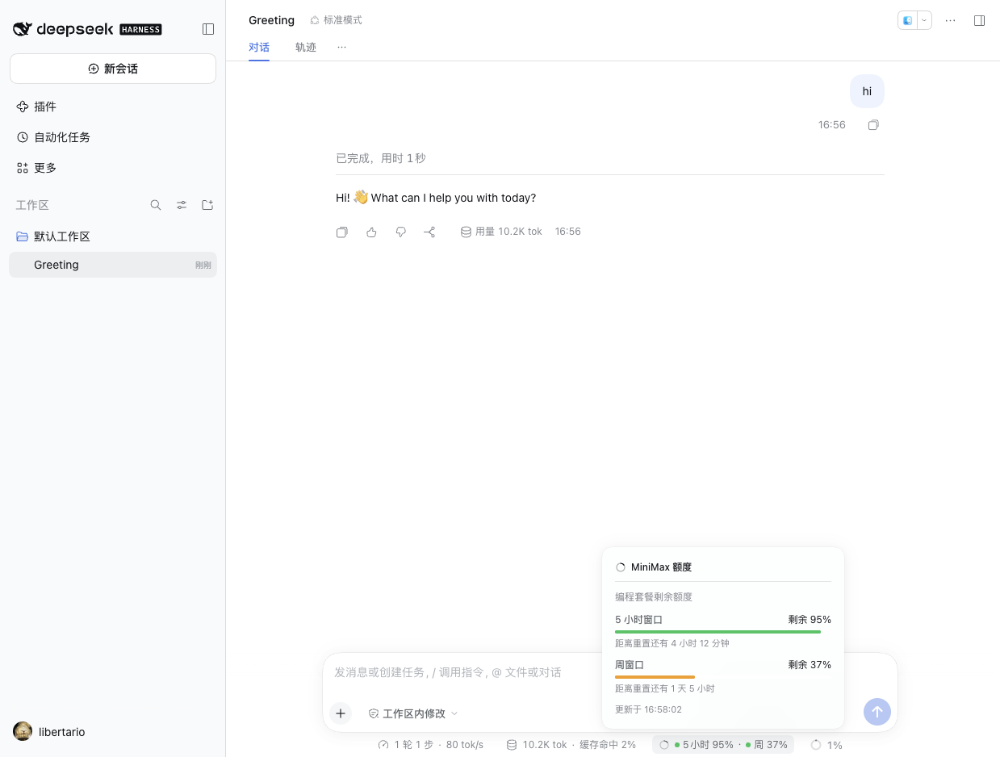
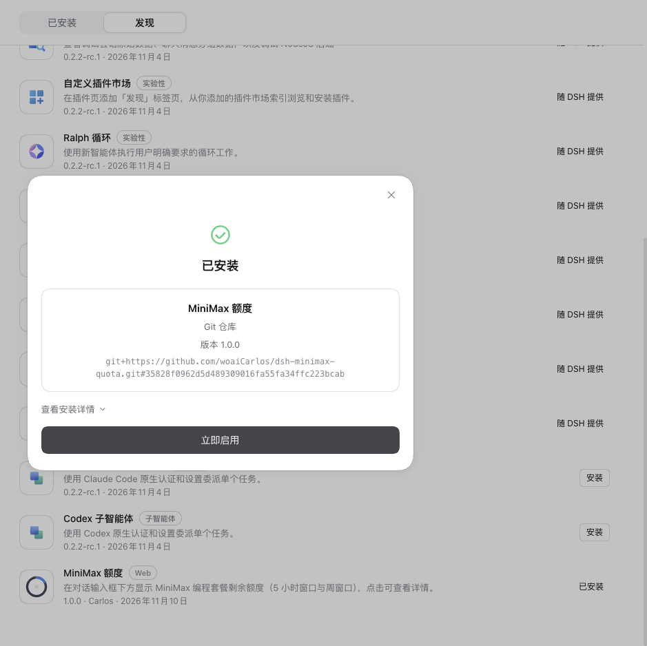

# dsh-minimax

在 DeepSeek Harness 的对话输入框下方，显示 **MiniMax 编程套餐（Coding Plan）剩余额度**：5 小时滚动窗口和周窗口各剩多少百分比。点击后弹出详情面板。同时，插件会探测 MiniMax 新发布的模型，把它们自动补进你的 pi-ai 模型列表。



- 只在当前会话选中 **MiniMax 系列模型**时出现（provider 或模型名含 `minimax`）。
- 药丸显示 `5小时 95% · 周 37%`，两个数字各带一个状态圆点：绿（>40%）、橙（≤40%）、红（≤15%）。
- 点击弹出面板：每个窗口的剩余百分比、进度条、距离重置还有多久、数据更新时间。
- 支持明暗主题；界面文案走 Harness 的 locale 服务（内置中英文）。
- 还会自动把 MiniMax 新发布的模型补进配置里的模型列表 —— 只追加，你已有的条目原样保留。

## 安装

插件通过 **GitHub 仓库**分发，不依赖 npm：

```bash
dsh plugin --profile <你的 profile> add github:woaiCarlos/dsh-minimax-quota
```

或者克隆后从本地目录安装：

```bash
git clone https://github.com/woaiCarlos/dsh-minimax-quota.git
dsh plugin --profile <你的 profile> add file:./dsh-minimax-quota
```

装完后在 **插件 → 已安装插件** 里能看到「MiniMax 额度」，开关打开即生效；重启 Harness 也生效。

> 如果你的 Profile 里还没有 MiniMax 路由，先在 **设置 → 模型** 里加一个 MiniMax 供应商并填入 API Key，插件才有额度可读。

## 出现在插件市场里

插件已经收录在本地插件市场的「发现」标签页里（索引条目带 commit 锁定的 GitHub 源，点一下就能装）。



如果你想让它出现在**社区插件市场**（awesome-dsh-plugin 目录，第三方市场按这个目录做发现），需要给
[awesome-dsh-plugin](https://github.com/awesome-dsh-plugin/awesome-dsh-plugin) 提一个 PR，
只加一个文件即可：

```yaml
# data/plugins/woaiCarlos__dsh-minimax-quota.yml
url: https://github.com/woaiCarlos/dsh-minimax-quota
name: woaiCarlos/dsh-minimax-quota
category: usage
description:
  en: 'Shows the remaining MiniMax coding-plan quota (5-hour window and weekly window) below the chat composer, with the detail on click.'
  zh: '在对话输入框下方显示 MiniMax 编程套餐剩余额度（5 小时窗口与周窗口），点击可查看详情。'
icon: https://raw.githubusercontent.com/woaiCarlos/dsh-minimax-quota/main/assets/icon-180.png
```

现成的文件在 [`catalog/awesome-dsh-plugin.yml`](catalog/awesome-dsh-plugin.yml)，直接复制改名即可。
仓库已经打了 `dsh-plugin` topic。

该目录的 CI 会检查**仓库至少存在满 1 天**，本仓库创建于 2026-11-10 09:04 UTC，
所以 PR 需要在 2026-11-11 09:04 UTC 之后提交。

另外，本地市场索引的生成脚本 `plugin-market/generate-index.mjs` 支持 Git 源的条目
（输入 `git-plugins.json`），用 DSH 自带的索引校验器校验后才写出 `index.json`。

## 发版

插件的**分发渠道就是这个 Git 仓库**，不是 npm。改完代码直接提交、发版即可：

```bash
git commit -am "..." && git push
```

插件市场索引里的版本条目用 commit SHA 锁定，所以每次发版后把
`plugin-market/git-plugins.json` 里的 `commit` 更新成新的 SHA，再重新生成索引：

```sh
cd plugin-market
DSH_MARKET_ON_DEMAND="$PWD/on-demand.json" node generate-index.mjs
```

### 如果以后还想发到 npm

仓库里已经备好了 npm 官方的 **Trusted Publishing（OIDC）**工作流
（`.github/workflows/publish.yml`），CI 里不保存任何长期 npm token：

一次性配置（npmjs.com 的包设置页）：

| 字段 | 值 |
| --- | --- |
| Select your publisher | GitHub Actions |
| Organization or user | `woaiCarlos` |
| Repository | `dsh-minimax-quota` |
| Workflow filename | `publish.yml` |

该工作流目前是**手动触发**（`workflow_dispatch`），因为包还不在 npm 上，
自动触发只会在每次打 tag 时失败。发包成功后可以改成 tag 触发：

```yaml
on:
  push:
    tags:
      - 'v*'
  workflow_dispatch:
```

首次发布（包还不存在，Trusted Publisher 还没法配）用一次性验证码：

```bash
npm publish --otp=<验证器 App 的 6 位码>
```

## 你的 API Key 会不会泄露

**不会。** 具体说：

1. **仓库里没有任何密钥。** 插件源码只出现一个**凭据引用名** `MINIMAX_CN_API_KEY`，它是「查哪个钥匙」的名字，不是钥匙本身。发布前已对整个目录做过密钥扫描，`sk-…` 形式的实际密钥一个都没有。

2. **密钥只存在于宿主进程。** 读取密钥的是 Host 半侧，通过 `ctx.credentials.resolve('MINIMAX_CN_API_KEY')` 从 Harness 的凭据存储里取，取到的值只用来拼 `Authorization: Bearer …` 请求头发给 MiniMax，**不会出现在路由返回的 JSON 里**。

3. **浏览器全程拿不到密钥。** 浏览器只请求同源路由 `/plugin/minimax/status`，拿到的只有百分比和重置时间戳：

   ```json
   {
     "ok": true,
     "intervalRemainingPercent": 95,
     "weeklyRemainingPercent": 37,
     "intervalResetAt": 1794316261854,
     "weeklyResetAt": 1794407213154,
     "intervalStatus": 1,
     "weeklyStatus": 1,
     "fetchedAt": 1794300583689
   }
   ```

   路由路径在服务端注册，密钥不会随响应下发。

### 安装后会自动识别吗

**会，前提是你的 MiniMax Key 是用「标准方式」配置的**——因为 Harness 自己的凭据存储就是按环境变量名寻址的：

| 你怎么配的 Key | 插件能不能读到 |
| --- | --- |
| 在 **设置 → 模型** 里给 MiniMax 填了 Key | ✅ 能，**无需额外操作** |
| 启动前 `export MINIMAX_CN_API_KEY=sk-…` | ✅ 能 |
| 项目目录 `.env` 或 `~/.dsh/.env` 里写了 | ✅ 能 |
| 存在别的名字的环境变量里 | ❌ 需要改配置，见下 |

原因是 Harness 的 **模型设置页** 在你给 `minimax-cn` 这条路由填 Key 时，写入的引用名是按路由 id 推导出来的：

```
minimax-cn  →  MINIMAX_CN_API_KEY
```

正好就是本插件查找的名字，所以**你只要在模型设置里配好了 MiniMax，装上插件就能直接用**，插件自己不会去猜别的 key。

查找顺序（Harness 凭据存储的固定优先级，第一个有值的胜出）：

```
1. 已存储的凭据文件   ~/.dsh/.credentials.yaml   ← 模型设置页写的就是这里
2. 启动时的环境变量   MINIMAX_CN_API_KEY=… dsh
3. 项目目录的 .env    <启动目录>/.env
4. 家目录的 .env      $DSH_HOME/.env
```

### 换一个引用名

如果你把 Key 存在了别的环境变量名里，改插件配置即可，在 `cordis.patch.yml` 里：

```yaml
- insert:
    - id: minimax
      name: 'dsh-minimax'
      config:
        credentialRef: MY_MINIMAX_KEY
```

## 配置

| 字段 | 默认值 | 含义 |
| --- | --- | --- |
| `credentialRef` | `MINIMAX_CN_API_KEY` | 要读取的凭据引用名。凭据存储里的引用名：字母、数字和下划线，且不能以数字开头。 |

## 工作原理

```
index.js    Host 半侧：解析凭据 → 调 MiniMax → 通过同源路由 /plugin/minimax/status 返回额度
client.js   浏览器半侧：在对话输入框下方注册一个药丸，点击弹出详情面板
locale/     中英文文案
```

### 模型自动补充

插件会探测 MiniMax 新发布的模型，把它们追加到 pi-ai 配置的 `providers.minimax-cn.models` 里。
每个新模型都会实测：是否还能调用、单次最大输出是多少、是否支持思考。
**你已有的条目不会被删除、不会被重排、也不会被改值** —— 插件只追加。手动删掉的模型也不会被加回来。

写回时有一处需要说明：pi-ai schema 解析出来的**路由级默认值**（`defaultContextWindow`、`defaultMaxTokens` 等）
会随这次写入一并落到 profile patch 的那条路由上；你写的**模型条目本身**按原样写回，一个字都不改。

### 同步的节奏

| 时机 | 会发生什么 |
| --- | --- |
| 插件启动后 | 等 profile 加载完，自动同步一次（最多重试 5 次） |
| 每 24 小时 | 自动扫描一次 MiniMax 的模型列表，有新模型就追加 |
| 面板里的「立即同步」 | 立刻同步一次，成功或失败都会在面板上给出提示 |

安静的一天只花 **1 次模型列表请求**：已追加过的模型、以及 MiniMax 已下线的模型，都记在插件自己的状态文件里，不会再探测。
MiniMax 已下线的模型只探测一次就记下结论，所以它不会每天再花两次请求。

### 状态文件

插件的簿记写在 profile 目录下的一个文件里，不落在你的 profile patch 里：

```
<profileDir>/dsh-minimax-state.json
{ "addedModels": ["MiniMax-M3.1-Flash"], "retiredModels": ["MiniMax-M2"], "lastSyncAt": 1760000000000 }
```

`addedModels` 记着插件追加过哪些模型 —— **你手动删掉的模型因此不会被加回来**；`retiredModels` 记着 MiniMax 已经下线的模型。
**删掉这个文件等于忘掉这些记录**：手动删掉的模型会在下次同步时重新出现，已下线的模型也会被重新探测一次。

### 数据来源

MiniMax 官方没有公开这个接口，是从其控制台前端产物里逆出来的（未文档化，可能变动）：

```
GET https://api.minimaxi.com/v1/coding_plan/remains
Authorization: Bearer <你的 Key>
```

关键字段：

| 字段 | 含义 |
| --- | --- |
| `model_remains[].current_interval_remaining_percent` | 5 小时窗口剩余百分比（**已经是剩余值**，不要再减 100） |
| `model_remains[].current_weekly_remaining_percent` | 周窗口剩余百分比 |
| `model_remains[].end_time` / `weekly_end_time` | 两个窗口的重置时间（epoch 毫秒） |
| `model_remains[].current_weekly_status` | 1 = 正常，2 = 周额度已用尽，**3 = 该套餐没有周额度**（此时不显示周那一档） |
| `base_resp.status_code` | 0 = 成功。**这个接口鉴权失败也返回 HTTP 200**，所以必须看 body 里的这个字段 |

代码里配了三个等价路径互相兜底（`coding_plan/remains`、`api/openplatform/coding_plan/remains`、`token_plan/remains`），因为路径随时可能变。

### 一些实现细节

- **Host 半侧声明了 `inject: ['webServer', 'credentials', 'settings', 'profileContext']`。** 这是必需的：`webServer` 服务由 web 应用包提供，可能晚于本插件加载；不声明依赖的话插件会在启动时抢跑，拿不到服务就静默跳过，路由注册不上（表现为界面显示「无法连接」）。`profileContext` 同样要声明：插件的簿记文件放在 profile 目录里，没有这个服务，插件会忘掉自己追加过哪些模型，于是你手动删掉的模型会被悄悄加回来。
- **额度每 60 秒刷新一次**，鼠标移到药丸上或点击时也会重新拉一次。
- **只在选中 MiniMax 模型时显示**；没有套餐额度（比如按量计费的账号）时整个药丸隐藏，不会显示空读数。
- 额度那部分是纯展示：不写任何会话事件，不改当前选中的模型，不参与 prompt。模型补充只往 profile 的 MiniMax 模型列表末尾追加条目。
- **每次同步都会在 Host 日志里记一行**，写明这次追加了几个模型；同步失败也会记下来（失败原因记在 Host 日志里，浏览器只看到一个固定提示）。

## 已知限制

- 只支持 MiniMax **国内版**（`api.minimaxi.com`）。国际版 `api.minimax.io` 是另一套账号体系，密钥不通用。
- 走的是未公开接口，MiniMax 改路径后需要更新 `index.js` 里的 `QUOTA_ENDPOINTS`。
- 纯按量计费（BYOK）账号没有套餐额度，插件会自动隐藏。

## License

MIT
